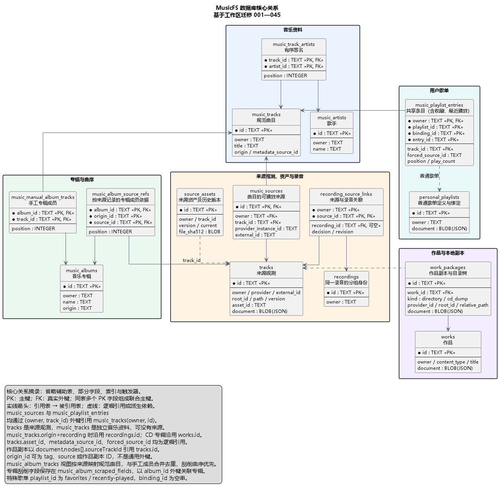

# 数据库结构图

本页记录 2026-11-20 工作区中 SQLite 迁移 001—045 对应的物理结构。主库共 96 张表（含加载器创建的 `schema_migrations`，不含 SQLite 内部表）和 10 个视图；插件私有状态使用独立数据库中的 `plugin_values` 表。这里描述已有建表定义，运行中的数据库版本取决于实际部署的 Server 与迁移状态。

结构以 [SQLite 迁移](../../plugins/database/sqlite/migrations/README.md)、[主库初始化](../../plugins/database/sqlite/store.go)及[实例状态建表](../../plugins/database/sqlite/state/store.go)为准。数据库后端的职责和访问边界见[存储后端](../plugins/storage-plugins.md)。

## 核心关系总览

实线从引用表指向被引用表，表示 SQL 外键；虚线表示逻辑引用或视图依赖。总览仅选取核心表及关键字段，完整物理字段见分域详图。



[可缩放 SVG](../diagrams/database-overview.svg) · [PlantUML 源码](../diagrams/database-overview.puml)

## 完整表结构

下表的分域详图覆盖主库全部 96 张表，每张表在所属领域展示全部字段；灰色节点仅展示跨域引用表的主键。`PK1`、`PK2` 等表示联合主键中的顺序，`FK` 表示真实外键列，字段前的实心圆表示 DDL 显式声明了 `NOT NULL`。箭头标签保留复合列映射和 `ON DELETE CASCADE`；其他唯一约束、索引、默认值、`CHECK` 和触发器需查看 SQL。

| 领域 | 表数 | 渲染图 | 可编辑源码 |
| --- | ---: | --- | --- |
| 音乐资料 | 12 | [SVG](../diagrams/database-catalog.svg) | [PlantUML](../diagrams/database-catalog.puml) |
| 来源、资产与识别证据 | 8 | [SVG](../diagrams/database-assets.svg) | [PlantUML](../diagrams/database-assets.puml) |
| 录音匹配与播放恢复 | 12 | [SVG](../diagrams/database-matching.svg) | [PlantUML](../diagrams/database-matching.puml) |
| 来源专辑、发行与作品包 | 12 | [SVG](../diagrams/database-albums-works.svg) | [PlantUML](../diagrams/database-albums-works.puml) |
| 歌单、收藏与播放历史 | 16 | [SVG](../diagrams/database-playlists.svg) | [PlantUML](../diagrams/database-playlists.puml) |
| 媒体内容、发布与备份 | 10 | [SVG](../diagrams/database-media.svg) | [PlantUML](../diagrams/database-media.puml) |
| 资料补全、自动化与原件写回 | 7 | [SVG](../diagrams/database-metadata.svg) | [PlantUML](../diagrams/database-metadata.puml) |
| 扫描、查询与固定快照 | 10 | [SVG](../diagrams/database-scanning.svg) | [PlantUML](../diagrams/database-scanning.puml) |
| 用户、会话与配置 | 9 | [SVG](../diagrams/database-system.svg) | [PlantUML](../diagrams/database-system.puml) |
| 独立实例状态库 | 1（不计入主库） | [SVG](../diagrams/database-state.svg) | [PlantUML](../diagrams/database-state.puml) |

## 数据语义

- `music_tracks` 保存可独立建档的音乐资料；`tracks` 保存插件来源观测；`source_assets` 保存不可变的资产版本。`source_assets.track_id` 与 `tracks.asset_id` 是业务逻辑引用，没有 SQL 外键。
- `recordings` 与 `recording_source_links` 维护录音归组；录音归并产生的音乐资料沿用录音 ID，`music_tracks` 与 `recordings` 之间没有外键。
- `music_album_tracks` 视图汇总手工成员与按来源记录的专辑成员，按逻辑曲目去重，优先使用 `music_album_scraped_track_refs` 中的曲序。`music_album_source_refs.origin_id` 可为 `tag`、`source` 或作品副本 ID，不能当作统一的作品包外键。
- `music_album_merged_slots` 记录人工合并的发行版曲位，供再次刮削时复用曲目。`music_artist_localized_names` 按歌手、语言和名称保存别名。
- 普通歌单、收藏和音乐最近播放共用 `music_playlist_entries`。特殊歌单的 `playlist_id` 使用 `favorites`、`recently-played`，`binding_id` 为空字符串，因此该列没有指向 `personal_playlists` 的外键；可空的 `forced_source_id` 由触发器校验归属。旧的 `personal_favorites`、`personal_recently_played` 表已在 038 中删除。
- `playlist_links` 关联个人歌单与平台歌单，`playlist_link_additions` 保存等待同步到平台的曲目。`recommendation_pages` 按用户和来源范围保存整页推荐，记录服务器日期及请求结果。
- 作品包的目录树与音轨引用存于 `work_packages.document`，通过 JSON 节点中的 `sourceTrackId` 引用来源。`document`、`request`、`description` 等 BLOB 列多为序列化业务模型；歌词、封面、缩略图及指纹明细正文存于独立文件，数据库保存索引、绑定和发布状态。
- 实例库的 `plugin_values` 按插件 ID 与实例 UUID 组成的 `scope` 隔离，以 `(scope,key)` 为联合主键，通过 `revision` 原子比较更新 JSON 值；它与主库之间没有跨库外键。

主库其余 9 个视图用于观测、导入和封面/元数据刷新：`music_observed_tracks`、`music_import_sources`、`music_imported_credits`、`music_import_cd_packages`、`music_import_cd_albums`、`music_track_covers`、`music_refresh_cover`、`music_refresh_metadata`、`music_refresh_album_cover`。详图只展开直接用于专辑查询的 `music_album_tracks`。其余视图定义及该视图的曲序变更见 [011—041 历史批次中的 037 和 041 迁移](../../plugins/database/sqlite/migrations/041_batch_011_041.sql)。

## 更新图示

在 Server 仓库根目录执行：

```powershell
python scripts/generate-database-diagrams.py
```

脚本只在内存 SQLite 中按原始版本重放迁移，检查外键与表清单，再生成十份分域 `.puml`；不会打开运行中的数据库。新增或删除表时需要更新脚本中的领域分组。核心总览由人工维护，变更核心数据关系后同步调整。

本次图示已使用 PlantUML 1.2024.3 渲染并检查。安装 Java、PlantUML 和 Graphviz 后，设置本机的 Java 与 JAR 路径，重新生成 SVG 及总览 PNG：

```powershell
$javaPath = 'C:\path\to\java.exe'
$plantumlJar = 'C:\path\to\plantuml.jar'
& $javaPath '-Dfile.encoding=UTF-8' -jar $plantumlJar -charset UTF-8 -failfast2 -overwrite -tsvg 'docs/diagrams/database-*.puml'
& $javaPath '-Dfile.encoding=UTF-8' -jar $plantumlJar -charset UTF-8 -failfast2 -overwrite -tpng docs/diagrams/database-overview.puml
```

生成后应重新检查图中中文、字段及连线，并同步更新本页版本、表数与日期。PlantUML 使用 `Microsoft YaHei` 字体，其他环境可安装该字体或选择支持中文的替代字体。
